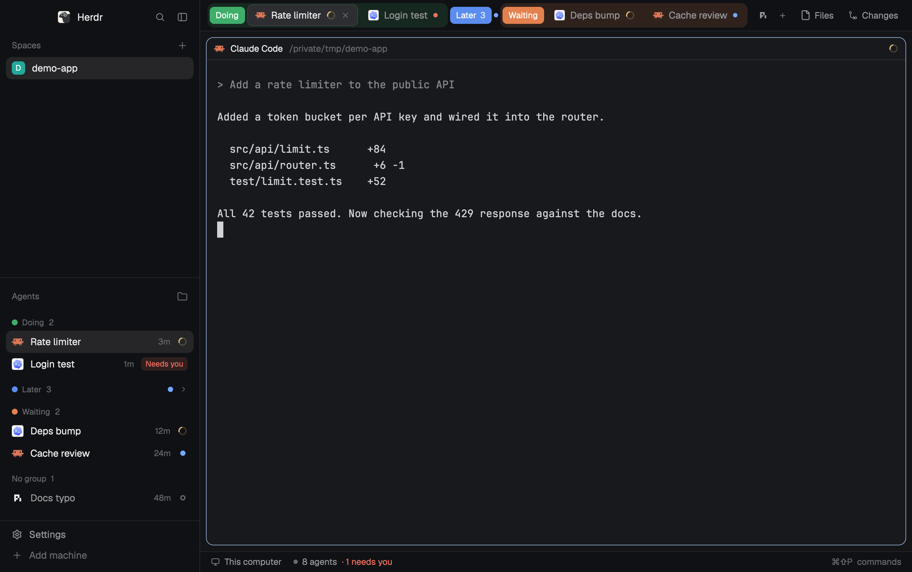

# Tab Groups

A [Herdr](https://herdr.dev) mod: tab groups like the ones in Chrome. Sort your tabs into Doing, Later, Waiting or anything you name, and fold a group away when you don't need to see it. The Agents list in the sidebar is split by the same groups.



- **Fold a group** by clicking its chip in the tab bar or its header in the Agents list. Folded tabs keep running, and `Cmd+number` and `tab.next` skip them, so the numbers match what you see.
- **Nothing gets lost.** A folded tab that needs your input comes back on its own, and a chip shows a spinner or a dot when something behind it is working or done.
- **Sort from the keyboard.** `Cmd+O` then `1` moves the current tab to the first group. You can also right-click a tab, or drag it onto a chip.
- **Agents go by their session.** A row in the Agents list shows its own agent's terminal title instead of the tab's name, so several agents in one tab stay apart. Claude Code writes the session's topic there. A row without a title shows the tab's name.

## Install

Tell your agent:

```text
Read ~/.config/herdr-app/AGENTS.md, then add this mod: https://github.com/imutaroh/herdr-tab-groups
```

Or by hand:

1. Copy `mods/tab-groups/` and `mods/agents-groups/` to `~/.config/herdr-app/mods/`.
2. Run `herdr-app check` on each folder.
3. Clone your layout, because shipped layouts are replaced on every start:

   ```sh
   herdr-app do layout.clone '{"name":"main","as":"my-layout"}'
   ```

4. In `~/.config/herdr-app/layouts/my-layout.json`, change `"mod": "tabs"` to `"mod": "tab-groups"`, and `"mod": "agents"` to `"mod": "agents-groups"`.
5. Add `"cmd-o": "mod.open:tab-groups"` to the `global` section of `~/.config/herdr-app/keys.json`. On Linux or Windows, pick another key.

To remove it, point the layout back at `tabs` and `agents`. Leaving the layout, or removing the mod from it, brings every folded tab back.

## Keys and clicks

| Where | What | Action |
| --- | --- | --- |
| Anywhere | `Cmd+O` | Open the group picker for the current tab |
| Picker | `1`-`9`, or `j` / `k` and `Enter` | Move the tab to that group |
| Picker | `f` | Fold or unfold the selected group |
| Picker | `n` | New group, with the tab in it |
| Picker | `e` | Edit the selected group |
| Picker | `x` | Take the tab out of its group |
| Chip | Click | Fold or unfold |
| Chip | Right-click | Name, color, fold, delete |
| Chip | Drag onto a tab or chip | Move the whole group |
| Tab | Right-click | Menu with the groups in it |
| Tab | Drag onto a chip or tab | Move it into that group, or out if the target has no group |
| Agents header | Click | Fold or unfold, the same as the chip |
| Agents row | Right-click | The same tab menu |

The button at the top right of the Agents list switches between this view and Herdr's Priority and Grouped by space views.

## What it touches

- Replaces the tab bar and Agents list in the layout you point at them. Both are copies of Herdr's own mods, so apart from the groups and the row names, those two places work as usual.
- Adds one key to `keys.json`.
- Runs no programs, makes no network requests, and reads no files outside the Herdr home.

The two mods go together: `agents-groups` reads the groups that `tab-groups` keeps.

## Limits

- `agent.next` and `agent.prev` still visit agents in folded groups. Herdr doesn't skip settled tabs there, and a mod can't leave an agent out of the order. The tab goes back into its group when you leave it.
- `Cmd+P` and other lists from Herdr don't know about groups, and still show folded tabs.
- Folding the group of the current tab from the Agents list keeps that tab on screen until you leave it. Folding from the chip moves to the next visible tab right away.
- Tested on macOS only, with Herdr 0.1.12 (the row names with 0.1.13). `tab-groups` and `agents-groups` are copies of the versions in 0.1.12, so they won't pick up later changes to Herdr's own tab bar and Agents list.

## License

Apache-2.0. Derived from mods shipped with [Herdr](https://github.com/herdrdev/herdr-app). See [NOTICE](NOTICE).
