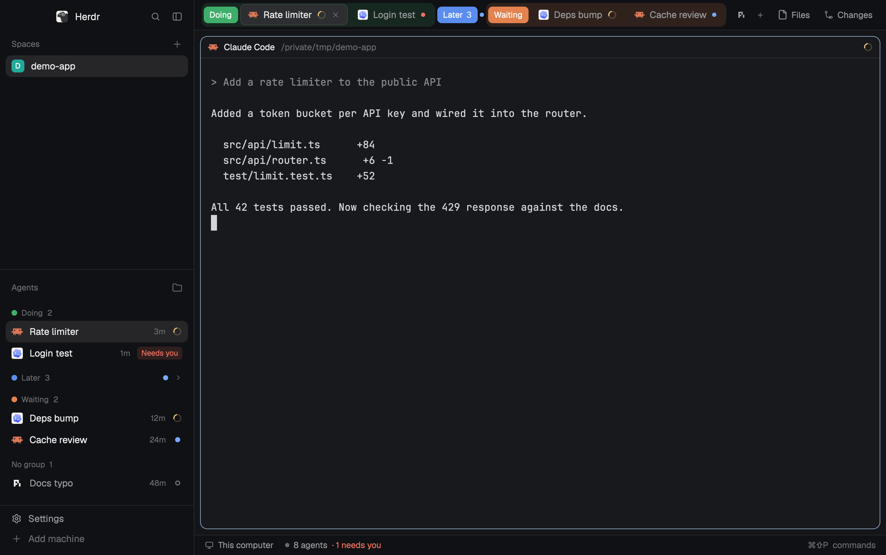

# Tab Groups

Tab groups like the ones in Chrome. Tabs sort into named, colored groups such as Doing, Later and Waiting. A group is a colored chip in the tab bar with its tabs beside it, and clicking the chip folds the tabs away while they keep running. The Agents list in the sidebar is split by the same groups, and folding either one folds both.

This file is the brief: enough to build Tab Groups from an empty folder. The files next to it are one build of it. If they don't work on your Herdr, or you want it different, build it again from here.

**Adding it:** copy both folders from `mods/`. They use `place: none`, so nothing appears until a layout names them. In a layout the person can edit (clone a shipped one with `layout.clone` first, because shipped layouts are replaced on every start), set the tab bar block's `content.mod` to `tab-groups` and the Agents block's to `agents-groups`, and keep each block's size and `window_drag`. Merge `keys.json`. It runs no programs, reaches no network, and reads no files outside the Herdr home.

## What you see

**Tab bar, in the layout's existing 42px block, left to right:**

- **Groups and ungrouped tabs**, in tab order. A group sits where its first tab is, with its members pulled together.
- **A chip** for each group with tabs in the shown space: 23px tall, 8px side padding, 6px radius, the group's color as its background, white semibold 11.5px text, the name up to 120px. A folded chip adds its member count at 80% opacity.
- **A group's tabs** beside its chip. The chip and tabs sit in a 33px block with a 9px radius and the group's color at 15% opacity behind them. A chip with no tabs showing has no such background.
- **A status mark** right after the chip when a hidden tab has news: a 6px dot in the theme's `done` color if one finished, otherwise a 12px spinner in `working` if one is working.
- **Tabs:** 29px tall, 7px radius, 12.8px text, names up to 170px, as in the shipped `tabs` mod: program icon, spinner when working, a 6px dot when blocked or done, and a close button on the shown tab. A tab inside a group has a transparent background so the group's color shows through.
- **`+`, Files and Changes**, unchanged from the shipped mod.

The six group colors: `#3fae6a`, `#5b8def`, `#e3814f`, `#8b7cf6`, `#22a99a`, `#d9649a`. A new group takes the least used one.

**Agents list, in the sidebar's existing block:** the shipped list with a third view, "Grouped by tab group", which is the default. Groups appear in tab bar order, and "No group" comes last. Only groups with agents appear. Each header is 30px tall with an 8px dot in the group's color, the name and member count in 11px medium text, and when folded a chevron and the most urgent status mark. Rows look the same as in the shipped list.

**Picker, a popup 340px wide, 40px from the top:** a title line (`Move "<tab>" to`), a 31px row for each group (number, 10px colored dot, name, a check if the tab is in it, member count, and `▸` or `▾`), a line, "New group", "Remove from group" when the tab is in one, and a key hint.

**Group editor, a popup 250px wide:** a name field, six 22px color circles with a ring on the current color, "Fold" or "Unfold", and "Delete group (keep tabs)".

**Tab menu, a popup 240px wide:** Rename, New tab, a line, a row for each group with a check on the current one, New group, Remove from group when in one, a line, Close.

## How it behaves

The first run has three groups: Doing, Later (folded) and Waiting. They exist in memory until the first change saves them.

**Moving tabs**

- `Cmd+O` opens the picker for the shown tab. `1`-`9` move it to that group and close the picker. `j` / `k` or the arrow keys select, `Enter` moves, `f` folds or unfolds the selected group, `e` edits it, `n` asks for a new group's name and puts the tab in it, `x` takes the tab out, `Esc` closes. Typing the name of an existing group uses that group.
- Right-clicking a tab, or an agent row in the sidebar, opens the tab menu. The arrow keys and `Enter` work there too.
- Pressing on a tab and releasing on a chip adds it to that group. Releasing on a tab in a group adds it at that position, and releasing on an ungrouped tab takes it out of its group and puts it there. There is no drag preview.
- Pressing on a chip and releasing on another chip or a tab moves the whole group.

**Folding**

- Clicking a chip or an Agents header flips the group's `folded` value. Right-clicking a chip, or `e` in the picker, opens the editor, where the name applies as you type.
- Folded tabs are hidden from the bar and put away with `tab.settle`, so `Cmd+number` and `tab.next` skip them.
- Folding the group of the shown tab from a chip or the picker moves to the next tab outside the group. From an Agents header the tab stays until you leave it.
- A shown tab in a folded group appears beside its chip, and goes away again when you leave it.
- Closing the shown tab, when Herdr then picks a tab in a folded group, moves on to a visible tab.

**Agent status, for a tab in a folded group**

| Status | Tab bar | Agents list |
| --- | --- | --- |
| working | Hidden, spinner beside the chip | Hidden, counted in the header |
| blocked | The tab comes back beside the chip with a blocked dot | The row stays under the header with "Needs you" |
| done | Hidden, done dot beside the chip | Hidden, done mark in the header |
| idle | Hidden, no mark | Hidden |

In an unfolded group each status looks as it does in the shipped mods.

**Elsewhere**

- Switching to a layout without `tab-groups` unsettles every tab, because the shipped tab bar doesn't read `settled`. Coming back hides them again.
- Groups are shared by all spaces. A chip counts and shows only the tabs in the shown space.
- Closed tabs are forgotten, once every machine has loaded.
- Double-clicking a tab renames it, and the wheel over the bar changes tabs, as in the shipped mod.

## Built from

- `mods/tab-groups/`: a copy of the shipped `tabs` mod (`place: none`, `overlay: {kind: "popup", at: "top", offset: 40, width: 340}`, so `mod.open` opens the picker at the top). One class picks a view from `props()`: no `overlay` is the tab bar, `group` is the editor, `target` (`{id, space}`) is the tab menu, otherwise the picker (optional `tab`, `create`).
- `mods/agents-groups/`: a copy of the shipped `agents` mod, made with `mod.clone`.
- **State:** `shared("tab-groups")` is `{groups: [{id, name, color, folded}], tabs: {tabId: groupId}}`. `agents-groups` reads it and writes only `folded`. Its chosen view is in `shared("agents-groups.sort")`.
- **Sync:** each second the tab bar compares the state to `spaces()`: `tab.settle` or `tab.unsettle` where a tab differs, `tab.move` where the order differs. A tab should be hidden when its group is folded, it isn't the shown tab, and its status isn't `blocked`.
- **`herdr` functions:** `spaces`, `panes`, `run`, `shared`, `setShared`, `openOverlay`, `closeOverlay`, `props`, `keys`, `machines`, `layout`, `settings`, `window`, `theme`, and in `agents-groups` also `agents`, `terminals`, `focused`, `setAgentOrder`.
- **Commands:** `tab.settle`, `tab.unsettle`, `tab.move`, `tab.select`, `tab.close`, `tab.new`, `tab.rename`, `tab.next`, `tab.prev`, `layout.show`, `layout.hide`, `layout.select`, `layout.resize`, `pane.focus`, `terminal.peek`, `window.minimize`, `window.maximize`, `window.close`.
- **Icons:** from shipped mods, by path: `mods/workspace-chrome/` (`spinner`, `plus`, `x`, `square`, `square-pen`, `check`, `folder`, `layers`, `clock`, `pin`, `pin-off`, `chevron-down`, `chevron-right`), `mods/pane/close.svg`, `mods/files/file.svg`, `mods/changes/changes.svg`, `mods/tabs/win-*.svg`.
- **Key:** `keys.json` binds `cmd-o` to `mod.open:tab-groups`.

## Watch out

Measured on Herdr 0.1.12:

- Herdr lifts a tab's settle when the tab is shown, and leaving doesn't restore it. It also lifts it when a settled tab's agent turns `done` or `blocked`, but settling it again sticks. That's why the sync runs on a timer.
- Settling the shown tab moves to the next unsettled tab. Settling a tab that is already settled does not move, so unsettle first.
- Closing the shown tab ignores settle when picking the next one.
- `run()` results don't reach `spaces()` in the same turn. `setShared` reads back right away. Don't sync right after `tab.move`, or the sync works from the old order and undoes it.
- `tab.select {index}` skips settled tabs, but `tab.move {index}` counts them.
- `agent.next` does not skip settled tabs. Leaving an agent out of `setAgentOrder` doesn't help, because missing agents are appended to the order.

In the code:

- The shipped `agents` mod reads an unknown `agents.sort` value as Priority. Keep this view on its own key, or a shipped layout's list changes.
- `"tab-groups"` is both the mod's folder name and its shared key, and `agents-groups` uses it for both too. If the folder has to be renamed, change `KEY` in `tab-groups` and `GROUPS_KEY` in `agents-groups`.
- Each mod's `localStorage` is its own, so the Agents list starts with no pins and no time stamps.
- `Cmd+P` and other shipped lists don't know about groups, and show folded tabs.
- Only tested on macOS. The window buttons for Windows and Linux are the shipped mod's and weren't exercised.

## Done when

- `herdr-app check` passes on both folders, and `herdr-app status` shows no errors with the layout pointing at them.
- `Cmd+O` opens the picker for the shown tab, and `1` puts that tab behind the first group's chip.
- Clicking a chip hides the group's other tabs and `herdr-app ls` shows them `settled`. `Cmd+number` and `tab.next` skip them.
- The Agents list shows one header per group with agents, in tab bar order, with "No group" last, and clicking a header does the same as clicking the chip.
- A folded tab whose agent reports `blocked` comes back beside its chip, and its row stays under the header with "Needs you".
- A folded tab whose agent reports `done` stays hidden, with a dot beside its chip.
- Selecting a hidden tab shows it beside its chip, and leaving hides it again.
- Switching to another layout unsettles every tab, and switching back hides the folded ones.
